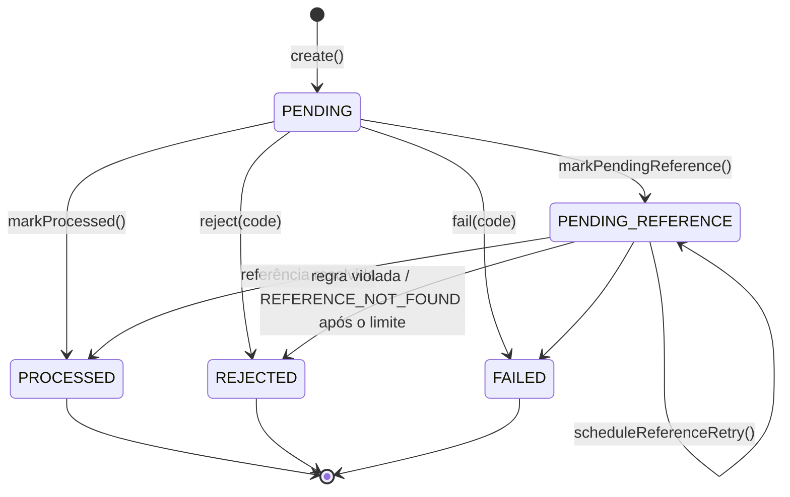

# ARCHITECTURE

Serviço financeiro que processa operações de apostas (`BET`, `WIN`, `LOSS`, `REFUND`, `ROLLBACK`) vindas de provedores via HTTP e SQS, mantendo **saldo materializado e ledger imutável sempre consistentes**, com idempotência persistente e correção sob múltiplas instâncias. O enunciado está em [`docs/CHALLENGE.md`](docs/CHALLENGE.md).

Sumário: [Visão geral](#1-visão-geral) · [Camadas](#2-camadas-e-fronteiras) · [MikroORM](#3-orm-mikroorm) · [Money](#4-money) · [Transações e concorrência](#5-estratégia-transacional-e-de-concorrência) · [Schema](#6-schema-e-constraints) · [Idempotência](#7-idempotência) · [Máquina de estados](#8-máquina-de-estados-da-wagertransaction) · [Regras](#9-regras-de-negócio-e-interpretações) · [Failure codes](#10-taxonomia-de-failurecode) · [HTTP](#11-mapeamento-http) · [Inbox/Outbox](#12-inbox-outbox-e-garantias-de-entrega) · [Retry/backoff](#13-políticas-de-retry-backoff-e-limites) · [DLQ](#14-dlq) · [Shutdown](#15-graceful-shutdown) · [Autenticação](#16-autenticação) · [Observabilidade](#17-observabilidade) · [Testes](#18-estratégia-de-testes) · [Trade-offs](#19-trade-offs-e-limitações-conhecidas) · [Com mais tempo](#20-o-que-eu-faria-com-mais-tempo)

---

## 1. Visão geral

```mermaid
flowchart LR
  subgraph Providers
    P1[Provider HTTP]
    P2[Provider SQS]
  end
  P1 -- "POST /wagering/transactions\nIdempotency-Key" --> API
  P2 -- "wager-transactions.fifo" --> CONS

  subgraph Instance["Instância da app (N réplicas, todas iguais)"]
    API[HTTP controllers] --> UC[SubmitWagerTransaction]
    CONS[SQS consumer] --> UC
    UC --> SET[WagerSettlement\n(domínio: WagerProcessor)]
    PW[Worker PENDING_REFERENCE] --> SET
    RELAY[Outbox relay]
  end

  subgraph PG["PostgreSQL (fonte da verdade)"]
    W[(wallets)]
    T[(wager_transactions)]
    L[(wallet_ledger_entries\nappend-only)]
    I[(inbox_messages)]
    O[(outbox_messages)]
  end

  SET -- "1 transação SQL:\nlock wallet → tx + ledger + wallet + inbox + outbox" --> PG
  RELAY -- "FOR UPDATE SKIP LOCKED" --> O
  RELAY -- "at-least-once" --> EV[[wallet-events.fifo]]
  CONS -. "erro permanente / retries esgotados" .-> DLQ[[wager-transactions-dlq.fifo]]
```

Princípios:

- **O banco é o árbitro final.** Lock por linha da wallet, checagem de versão, `UNIQUE`/`CHECK`/FKs/triggers. Ordenação e dedup do SQS FIFO são otimizações.
- **Um único caminho de liquidação** (`WagerSettlement` + `WagerProcessor`) para HTTP, SQS e o worker de referências pendentes.
- **Tudo ou nada**: transação, saldo, ledger, inbox e outbox no mesmo `COMMIT`. Nada é publicado antes do commit (só o relay da outbox publica eventos).
- **Instâncias idênticas e sem estado.** Todas rodam HTTP, consumer, relay da outbox e worker; a coordenação é feita só pelo PostgreSQL (`FOR UPDATE`, `SKIP LOCKED`, leases).

## 2. Camadas e fronteiras

```
src/
  domain/          Money, Wallet, WagerTransaction, WalletLedgerEntry, InboxMessage, OutboxMessage,
                   IntegrationEvent + 4 subclasses, WagerProcessor (regras), FailureCode, BackoffPolicy,
                   hash canônico. Zero dependência de Nest/ORM (só decimal.js e node:crypto).
  application/     use cases (CreateWallet, SubmitWagerTransaction, ProcessPendingReferences, PublishOutbox,
                   ReconcileWallet, WalletQueries, RecordPermanentFailure), WagerSettlement, portas
                   (UnitOfWork, repositórios, Clock, IdGenerator, EventPublisher, MetricsPort, LoggerPort,
                   ProviderIdentityPort) e erros de aplicação.
  infrastructure/  MikroORM (EntitySchema, mappers, repositórios, UnitOfWork, migrations), SQS (cliente,
                   bootstrap de filas, publisher), workers/lifecycle, métricas (prom-client), logs (pino), config.
  interfaces/      adaptadores de entrada: controllers HTTP + filtro de exceções + guard, consumer SQS,
                   contratos de wire (zod) compartilhados por HTTP e SQS.
```

- Use cases são classes TypeScript puras instanciadas por `useFactory` no `AppModule`; o Nest fica restrito à composição e a `interfaces/`.
- O consumer SQS mora em `interfaces/messaging` porque é um **adaptador de entrada**, como um controller. O cliente SQS e o publisher (adaptadores de saída) ficam em `infrastructure/`.
- Modelagem (seção 6 do enunciado): construtores `private`, factories `create`/`open`/`from`/`receive`/`enqueue`, e `rehydrate`, que **não revalida** transições. Estado mutável é privado e muda só por métodos de transição. `WalletLedgerEntry` não tem setters nem transições e é `Object.freeze`d.

## 3. ORM: MikroORM

Por que MikroORM (preferencial no enunciado): `em.transactional()` explícito, `LockMode` (incluindo `PESSIMISTIC_PARTIAL_WRITE` = `FOR UPDATE SKIP LOCKED`), driver PostgreSQL maduro e migrations programáticas.

Como ele é usado:

| Necessidade | Recurso |
|---|---|
| Transação | `orm.em.fork({clear:true}).transactional(cb)`: um fork por tentativa, com identity map limpo |
| Lock da wallet | `em.findOne(WalletSchema, {id}, {lockMode: PESSIMISTIC_WRITE})` → `SELECT … FOR UPDATE` |
| Reconciliação | `PESSIMISTIC_READ` → `FOR SHARE` |
| Outbox | `em.find(..., {lockMode: PESSIMISTIC_PARTIAL_WRITE, limit, orderBy occurredAt})` → `FOR UPDATE SKIP LOCKED` |
| Update com versão | `em.nativeUpdate(WalletSchema, {id, version: old}, {...})`; 0 linhas → `ConcurrencyConflictError` |
| Inserts | `em.insert` / `em.insertMany` (imediatos, com ordem e ponto de erro previsíveis) |
| SQL específico | `em.execute`: `INSERT … ON CONFLICT DO NOTHING` (inbox), claim com lease (`UPDATE … FROM (SELECT … FOR UPDATE SKIP LOCKED)`), `SUM` do ledger |

Decisões:

- **Persistência separada do domínio**: `EntitySchema` + *records* + mappers em `infrastructure/persistence`. O domínio não tem decorators, e o MikroORM não precisa de `reflect-metadata` para as entidades.
- **Sem flush implícito do Unit of Work para escrita.** Os writes são explícitos (`insert`/`nativeUpdate`) porque a ordem importa (FKs, triggers de cadeia) e o `UPDATE` da wallet precisa da condição de versão escolhida pela aplicação, não do auto-incremento de `version` do ORM. O Unit of Work da aplicação é a própria transação SQL (`UnitOfWork.run`).
- **Bun**: não houve incompatibilidade. As migrations são registradas por `migrationsList` (sem glob de arquivos), então funcionam iguais em Bun, no Docker e no Windows.
- **Migrations reversíveis**: 3 migrations com `up` e `down` (`bun run migration:up|down`, `bun scripts/migrate.ts down --all`). Um teste aplica up → down (1 passo) → down (tudo) → up num banco temporário.

## 4. Money

- `Money` é imutável, guarda um `Decimal` (`decimal.js`, construtor clonado com precisão 40, sem tocar a config global) e a `currency` ISO-4217. Toda operação devolve uma instância nova; operações entre moedas diferentes lançam `CurrencyMismatchError`.
- **Contrato de entrada** (`Money.from`): só strings. A regex `^(0|[1-9]\d{0,17})(\.\d{1,2})?$` rejeita `NaN`, `Infinity`, notação científica, vazio, sinais, zeros à esquerda, separadores, mais de 2 casas e mais de 18 dígitos inteiros (limite do `NUMERIC(20,2)`). Número JSON (`"amount": 10`) é erro de validação (400/DLQ), nunca coerção.
- **Interpretação:** `"25"` e `"25.5"` são aceitos e **normalizados** para `"25.00"`/`"25.50"`. Toda serialização sai com escala 2. O hash de idempotência usa o valor normalizado, então `"25"` e `"25.00"` são o mesmo payload.
- `Money.fromPersisted` aceita sinal (diferença da reconciliação pode ser negativa) e é usado só para dados confiáveis (banco).
- **Banco**: `NUMERIC(20,2)` + coluna `currency CHAR(3)`. O driver devolve `NUMERIC` como string, o schema MikroORM usa `type: 'decimal'` (string), e o mapper faz `string ⇄ Money`. O `SUM` da reconciliação é feito em SQL e volta como `::text`. Nenhum valor monetário passa por `number` (há um grep de verificação no `PROGRESS.md`).

## 5. Estratégia transacional e de concorrência

**Unidade de concorrência = `walletId`.** Fluxo de `SubmitWagerTransaction` (HTTP e SQS), numa única transação `READ COMMITTED`:

```
BEGIN; SET LOCAL lock_timeout = '2000ms'
 [SQS] INSERT inbox (consumer, messageId) ON CONFLICT DO NOTHING   → já existia? devolve o resultado gravado
 SELECT tx WHERE idempotency_key = $k                              → existe? replay (hash igual) ou 409
 SELECT wallet … FOR UPDATE                                         ← serializa só esta wallet
 SELECT tx WHERE idempotency_key = $k                              → re-checagem sob o lock
 SELECT tx WHERE (provider_id, external_transaction_id)             → existe com outra key? 409
 resolve referência (provider_id, reference_external_transaction_id) + "já revertida?"
 WagerProcessor.decide() → PROCESS | REJECT | WAIT_FOR_REFERENCE    (domínio puro)
 INSERT wager_transactions (com balance_snapshot)
 UPDATE wallets SET balance, version = old+1 WHERE id = $1 AND version = $old   (0 linhas → conflito)
 INSERT wallet_ledger_entries
 INSERT outbox_messages (1..2 eventos)
COMMIT   ← triggers deferidos validam saldo ⇄ ledger aqui
```

Por que **lock pessimista por linha + versão**:

- O cenário central do desafio é a *hot wallet* (duas apostas disputando o mesmo saldo). Com `FOR UPDATE`, as operações da mesma wallet fazem fila no banco e cada uma vê o saldo já confirmado da anterior. Não há *lost update* nem tempestade de retries. Wallets diferentes não se bloqueiam (lock de linha, nunca global).
- A re-checagem de idempotência **depois** do lock fecha a corrida de duplicatas da mesma wallet: em `READ COMMITTED` cada statement enxerga o que foi confirmado antes dele, então a segunda requisição idêntica, ao ganhar o lock, já encontra a primeira. (Teste: 50 cópias paralelas em 3 instâncias → 1 débito.)
- `WHERE version = $old` é **defesa em profundidade**: se um caminho futuro esquecer o lock, o update não casa e a unidade é refeita.
- **Ordem de locks fixa** (wallet → linha da transação, no worker) evita deadlocks entre o caminho síncrono e o worker.
- `lock_timeout` curto (2 s, configurável) evita que uma wallet muito disputada prenda conexões do pool. Deadlock (`40P01`), serialization (`40001`), lock timeout (`55P03`) e version mismatch disparam **retry da unidade inteira** com backoff exponencial e jitter (até `TX_MAX_RETRIES`=5). Cada ocorrência conta em `lock_conflicts_total{reason}` e `retries_total{reason}`. Esgotado o limite, vira `TransientInfrastructureError` → HTTP 503 + `Retry-After` / SQS com backoff de visibilidade.

Alternativas consideradas:

| Alternativa | Por que não |
|---|---|
| Optimistic locking puro (retry) | Sob hot wallet a maioria das tentativas colide e o throughput cai em espiral; exige retries ilimitados ou falhas espúrias |
| `UPDATE … SET balance = balance - $x WHERE balance >= $x` | Ótimo para débito simples, mas reversões precisam ler a referência, checar "já revertida" e gravar `balance_before/after` coerentes. Acabaria precisando do lock de qualquer jeito |
| `SERIALIZABLE` | Correto, mas transfere o custo para abortos e retries; o lock explícito é mais previsível e mais fácil de explicar |
| Advisory lock por wallet | Funciona, mas é um segundo mecanismo fora da linha que de fato protegemos; `FOR UPDATE` já é o lock certo |
| Confiar no `MessageGroupId` do FIFO | Proibido pelo enunciado como garantia; HTTP e SQS concorrem pela mesma wallet de qualquer forma |

## 6. Schema e constraints

As invariantes estão **no schema** (o código também as respeita, mas o banco recusa violações mesmo vindas de SQL manual). Cada item abaixo tem teste em `test/integration/schema-constraints.test.ts` que tenta violá-lo com SQL bruto.

**`wallets`**

| Constraint | Por quê |
|---|---|
| `UNIQUE (player_id, currency)` | no máximo uma wallet por jogador+moeda (corrida de criação resolvida pelo banco → 409) |
| `CHECK (balance >= 0)` | saldo nunca negativo, mesmo com bug ou SQL manual |
| `CHECK (version >= 1)` | versão começa em 1 |
| `UNIQUE (id, currency)` | alvo da FK composta do ledger (linha do ledger na moeda da wallet) |
| trigger `wallets_guard` | identidade imutável; `version` muda **exatamente +1 sse o saldo muda**; `DELETE` proibido |
| constraint trigger **deferida** `wallets_balance_matches_ledger` | no COMMIT, `(balance, version)` precisa ter uma linha de ledger com `wallet_version = version` e `balance_after = balance`. Saldo e ledger não conseguem divergir por nenhum caminho que respeite triggers |

**`wager_transactions`**

| Constraint | Por quê |
|---|---|
| `UNIQUE (provider_id, external_transaction_id)` | uma operação do provedor existe uma vez |
| `UNIQUE (idempotency_key)` | idempotência persistente; resolve corrida entre réplicas |
| `payload_hash CHAR(64) NOT NULL` + `CHECK` hex | detectar mesmo key com payload diferente |
| `CHECK kind`, `CHECK status` válidos | enum no banco |
| `CHECK (kind = 'LOSS' OR amount > 0)`, `amount >= 0` | valores de entrada positivos (LOSS pode ser 0) |
| `CHECK` REFUND/ROLLBACK ⇒ `reference_external_transaction_id` | regra 7.1 |
| `CHECK` PROCESSED + REFUND/ROLLBACK ⇒ `reference_transaction_id` | reversão aplicada sempre aponta para a referência resolvida |
| `CHECK (status IN (REJECTED,FAILED)) = (failure_code IS NOT NULL)` | toda rejeição tem código; nada além disso tem |
| `CHECK` PROCESSED ⇒ `processed_at`; PENDING_REFERENCE ⇒ `next_attempt_at` | consistência de estado |
| `CHECK ((kind='OPENING') = (provider_id='internal'))` | OPENING é interno |
| FK `wallet_id → wallets`, FK `reference_transaction_id → wager_transactions` | integridade referencial |
| **`UNIQUE (reference_transaction_id) WHERE status='PROCESSED' AND kind IN ('REFUND','ROLLBACK')`** | uma transação é revertida **no máximo uma vez no total** (ver §9). Reversões REJECTED continuam gravadas para auditoria |
| trigger `wager_tx_guard` | estados terminais congelados, campos de negócio imutáveis, `DELETE` proibido (trilha de auditoria) |
| índices parciais `(next_attempt_at) WHERE PENDING_REFERENCE` e `(provider_id, reference_external_transaction_id) WHERE PENDING_REFERENCE` | varredura do worker e "acordar" dependentes quando a referência chega |
| `UNIQUE (id, wallet_id)` | alvo da FK composta do ledger |

**`wallet_ledger_entries`** (append-only)

| Constraint | Por quê |
|---|---|
| `CHECK (amount > 0)`, `balance_before >= 0`, `balance_after >= 0` | lançamentos sempre positivos, saldos nunca negativos |
| `CHECK` aritmético (`CREDIT: after = before + amount`, `DEBIT: after = before - amount`) | cada linha é aritmeticamente correta |
| `UNIQUE (transaction_id, wallet_id)` | no máximo um lançamento por wallet por transação |
| `UNIQUE (wallet_id, wallet_version)` | sequência por wallet sem bifurcação; dois lançamentos "concorrentes" na mesma versão são impossíveis |
| trigger `ledger_chain` (BEFORE INSERT) | `balance_before` da versão N = `balance_after` da versão N-1 (cadeia contínua) |
| FK `(wallet_id, currency) → wallets(id, currency)` | lançamento na moeda da wallet |
| FK `(transaction_id, wallet_id) → wager_transactions(id, wallet_id)` | lançamento pertence à wallet da transação |
| constraint trigger deferida `ledger_matches_transaction` | no COMMIT, a transação está PROCESSED, não é LOSS, tem o mesmo valor e moeda e direção compatível (BET=DEBIT; WIN/REFUND/OPENING=CREDIT); a wallet alcançou essa versão |
| triggers `BEFORE UPDATE/DELETE` (row) e `BEFORE TRUNCATE` (statement) | **imutabilidade** |
| índice `(wallet_id, created_at, id)` | paginação por cursor (keyset) |

**`inbox_messages`**: `PRIMARY KEY (consumer_name, message_id)`.
**`outbox_messages`**: índice parcial `(next_attempt_at, occurred_at) WHERE published_at IS NULL` (o índice só contém o que falta publicar), `CHECK (payload->>'eventId' = id)`, `CHECK` pendente ⇒ agendado.

## 7. Idempotência

- Header **`Idempotency-Key` obrigatório** (400 `IDEMPOTENCY_KEY_REQUIRED`). Ele é a fonte da verdade; default recomendado `{providerId}:{externalTransactionId}`. Na fila, o campo é `data.idempotencyKey`.
- **`payloadHash`** = SHA-256 (hex minúsculo) do **JSON canônico** dos campos de negócio `providerId, externalTransactionId, playerId, walletId, roundId, gameId, kind, money{amount,currency}, referenceExternalTransactionId`:
  - chaves ordenadas recursivamente (ordem de code unit UTF-16), sem espaços, opcionais ausentes omitidos;
  - `money.amount` normalizado para escala 2 antes do hash;
  - só strings/booleans/null/inteiros: um float faz o serializador lançar erro, então dinheiro como número nunca entra no hash;
  - **fora** do hash: o próprio header, `messageId`, `occurredAt`, correlation id e qualquer metadado de transporte.
  - Código: `src/domain/shared/canonical-json.ts` e `src/domain/wagering/payload-hash.ts`.
- **Fluxo**: lookup por `idempotency_key`. Hash igual → **replay** com o resultado gravado (`status`, `failureCode` e o `balance_snapshot` observado naquele momento, não o saldo atual) e `idempotentReplay: true`. Hash diferente → **409** `IDEMPOTENCY_KEY_PAYLOAD_MISMATCH`, sem replay.
- **Corrida**: duplicatas para a mesma wallet são serializadas pelo lock e resolvidas pela re-checagem. Duplicatas com o mesmo key mas `walletId` diferente (locks diferentes) batem na `UNIQUE(idempotency_key)`: a transação faz rollback, a aplicação captura a violação e repete o lookup, que devolve replay ou 409.
- Mesmo `(providerId, externalTransactionId)` com **outra** key → 409 `EXTERNAL_TRANSACTION_ID_CONFLICT` (o provedor reaproveitou um id; não é replay).
- Replay de uma transação que estava `PENDING_REFERENCE` e já foi resolvida devolve o **estado atual** (ex.: 200 PROCESSED). O resultado de uma transação que ainda está pendente é, por definição, o estado corrente.
- **Nenhum cache em memória**: toda decisão de idempotência lê o PostgreSQL.
- **SQS**: além da idempotency key, a inbox `(consumer_name, message_id)` deduplica a mesma mensagem. O `message_id` é o `messageId` do envelope de negócio, não o id interno do SQS, então um reenvio do mesmo envelope também é detectado.

## 8. Máquina de estados da WagerTransaction



- `PROCESSED`, `REJECTED`, `FAILED` são terminais: qualquer transição lança `InvalidTransactionStateError` (erro de programação), e o trigger `wager_tx_guard` recusa o mesmo no banco.
- `PENDING` existe só em memória durante a decisão. Toda linha é gravada já no estado decidido, porque decidir e gravar acontecem na mesma transação.
- `OPENING` nasce por `createOpening` (interno); `create` recusa `OPENING`.

## 9. Regras de negócio e interpretações

Implementadas em `WagerProcessor.decide` (puro, testado em `test/unit/wager-rules.test.ts`):

| Operação | Efeito | Ledger | Regra |
|---|---|---|---|
| BET | débito | 1 DEBIT | `INSUFFICIENT_FUNDS` se saldo < valor |
| WIN | crédito | 1 CREDIT | referência à BET da mesma rodada **opcional** |
| LOSS | nenhum | nenhum | PROCESSED; publica `WagerTransactionProcessed`; `version` não muda |
| REFUND | crédito | 1 CREDIT | só referencia BET PROCESSED, mesmo valor |
| ROLLBACK | inverso da referência | 1 invertido | referencia BET (→ crédito), WIN ou REFUND (→ débito; `REVERSAL_WOULD_OVERDRAW` se faltaria saldo) |

Ordem das checagens: jogador da wallet (`WALLET_PLAYER_MISMATCH`) → moeda (`CURRENCY_MISMATCH`) → referência ausente (espera) → tipo da referência (`INVALID_REFERENCE_KIND`) → mesmo provider/player/wallet/moeda/rodada (`REFERENCE_MISMATCH`) → referência ainda pendente (espera) → referência não PROCESSED (`REFERENCE_NOT_PROCESSED`) → valor (`AMOUNT_MISMATCH`) → já revertida (`ALREADY_REVERSED`) → saldo.

Interpretações adotadas:

1. **Reversão única no total.** O enunciado diz "não pode ser revertida duas vezes pelo mesmo tipo de operação". Adotei a leitura mais estrita: uma transação é revertida **uma vez, por REFUND *ou* ROLLBACK**. REFUND seguido de ROLLBACK da mesma BET creditaria a aposta duas vezes, que é exatamente a duplicação de crédito proibida pelas invariantes globais. O índice único parcial garante isso no banco.
2. **ROLLBACK de REFUND** é permitido (enunciado), e debita. Depois disso, a BET original **não** pode ser reembolsada de novo (o REFUND continua existindo como PROCESSED). Isso é conservador e auditável.
3. **WIN/LOSS com referência**: se informada, precisa ser uma BET da mesma rodada/wallet; se ainda não chegou, a operação vai para `PENDING_REFERENCE` como as reversões (mesma semântica de "fora de ordem").
4. **LOSS** aceita `amount` = `0.00` (provedores costumam mandar a perda sem valor); os demais tipos exigem `amount > 0`.
5. **Wallet inexistente**: não há linha onde ancorar a transação (FK), então ela **não é persistida**. A resposta é 422 `WALLET_NOT_FOUND` com `transactionId: null`. Na fila, a inbox é gravada e a mensagem é confirmada. Um reenvio depois que a wallet existir será processado normalmente.
6. **Replay de REJECTED** devolve 422 com `idempotentReplay: true`; o provedor recebe a mesma resposta.
7. **Referência resolvida por `(providerId, referenceExternalTransactionId)`**: o provider da referência é sempre o mesmo da operação (por construção da busca).
8. **OPENING**: saldo inicial > 0 cria a transação `OPENING` (provider `internal`, `PROCESSED`) e o CREDIT, na mesma transação da wallet. `version` continua 1 (a abertura faz parte da criação). Saldo inicial 0 não gera ledger.
9. **Timestamps** vêm do `Clock` da aplicação (mesmo relógio para `created_at`, `next_attempt_at` etc.). Em produção multi-host isso pressupõe NTP. Ver limitações.

## 10. Taxonomia de FailureCode

Códigos estáveis (só se adicionam valores, nunca se renomeiam). A resposta inclui `providerAction`:

| failureCode | Quando | O provedor deve |
|---|---|---|
| `INSUFFICIENT_FUNDS` | BET maior que o saldo | **desistir** (a aposta foi recusada; reenviar devolve o mesmo resultado) |
| `REVERSAL_WOULD_OVERDRAW` | ROLLBACK de WIN/REFUND deixaria saldo negativo | **desistir** e acionar operação (caso operacional: o jogador já gastou o crédito) |
| `CURRENCY_MISMATCH` | moeda ≠ moeda da wallet | **corrigir** (nova operação) |
| `WALLET_NOT_FOUND` | wallet não existe | **corrigir** walletId |
| `WALLET_PLAYER_MISMATCH` | wallet é de outro jogador | **corrigir** |
| `REFERENCE_NOT_FOUND` | referência não chegou dentro do limite de tentativas | **corrigir** a referência / enviar a operação original e depois uma nova reversão |
| `REFERENCE_MISMATCH` | referência de outro player/wallet/moeda/rodada | **corrigir** |
| `INVALID_REFERENCE_KIND` | ex.: REFUND de WIN, ROLLBACK de LOSS | **corrigir** |
| `REFERENCE_NOT_PROCESSED` | referência foi REJECTED/FAILED (ou nunca saiu de pendente) | **desistir** (não há o que reverter) |
| `ALREADY_REVERSED` | a referência já tem REFUND/ROLLBACK aplicado | **desistir** (o efeito desejado já existe) |
| `AMOUNT_MISMATCH` | valor ≠ valor da referência (reversão parcial fora de escopo) | **corrigir** |
| `OPENING_NOT_ALLOWED` | tentativa de submeter OPENING | **corrigir** (400) |
| `INFRASTRUCTURE_PERMANENT_FAILURE` | mensagem SQS esgotou as tentativas por falha de infraestrutura → `FAILED` | **desistir** e acionar suporte (estado terminal auditável) |

Erros que não são rejeição de negócio (sem linha gravada) usam `code`: `INVALID_PAYLOAD`, `INVALID_MONEY`, `REFERENCE_REQUIRED`, `IDEMPOTENCY_KEY_REQUIRED`, `IDEMPOTENCY_KEY_PAYLOAD_MISMATCH`, `EXTERNAL_TRANSACTION_ID_CONFLICT`, `WALLET_ALREADY_EXISTS`, `NOT_FOUND`, `INVALID_ID`, `INVALID_CURSOR`, `TEMPORARILY_UNAVAILABLE` (**reenviar** com a mesma key).

## 11. Mapeamento HTTP

Igual em todos os endpoints (filtro único `HttpExceptionFilter`; o status de submissão vem do resultado):

| Situação | Status | Corpo | Pode reenviar? |
|---|---|---|---|
| Processada | **200** | `{transactionId, status:PROCESSED, balance, idempotentReplay}` | é idempotente |
| Replay | **200**/202/422 (o mesmo do original) | `idempotentReplay: true` | – |
| Wallet criada | **201** | `{id, playerId, balance, version}` | – |
| Aceita, aguardando referência | **202** | `status: PENDING_REFERENCE` | sim (consulta o estado) |
| Rejeição de regra de negócio | **422** | `{transactionId, status:REJECTED, failureCode, providerAction, balance, idempotentReplay}` | não |
| Payload inválido / header ausente / id malformado | **400** | `{code, message, details}` | não sem corrigir |
| Recurso inexistente (GET) | **404** | `{code: NOT_FOUND}` | – |
| Conflito de idempotência / external id / wallet duplicada | **409** | `{code, existingTransactionId|existingWalletId}` | não |
| Falha transitória (DB/SQS indisponível, locks esgotados) | **503** + `Retry-After: 1` | `{code: TEMPORARILY_UNAVAILABLE, retryable:true}` | **sim, com a mesma key** |
| Replay de FAILED | 500 | `failureCode: INFRASTRUCTURE_PERMANENT_FAILURE, retryable:false` | não |

Todo corpo de erro tem `retryable` e `correlationId`, então o provedor decide sem interpretar texto.

## 12. Inbox, outbox e garantias de entrega

**Outbox (transactional outbox):**

- O evento é gravado na mesma transação da mudança financeira (`OutboxMessage.enqueue(event)`; o id da linha é o `eventId`).
- O relay roda em **todas** as instâncias: `BEGIN; SELECT … WHERE published_at IS NULL AND next_attempt_at <= now ORDER BY occurred_at LIMIT n FOR UPDATE SKIP LOCKED; SendMessageBatch; UPDATE published_at | scheduleRetry; COMMIT`.
- `SKIP LOCKED` dá lotes disjuntos a publishers concorrentes (teste com 2 processos: soma dos publicados = total, nenhum perdido).
- **Crash depois de publicar e antes do COMMIT**: a conexão cai, os locks são liberados, as linhas continuam pendentes e outra instância publica de novo. Logo a entrega é **at-least-once**. O teste `crash_after_publish` usa uma fila *standard* para que o SQS não esconda a duplicata e mostra 40 entregas de 20 eventos; com dedup por `eventId` sobram exatamente 20.
- **Commit e morte antes de publicar**: as linhas ficam pendentes e qualquer instância viva publica (testado).
- Fila de eventos `wallet-events.fifo`: `MessageGroupId = aggregateId` (walletId), `MessageDeduplicationId = eventId`. O dedup de 5 min do SQS é bônus. **Consumidores devem deduplicar por `eventId`** (ex.: inbox própria) e, para `WalletBalanceChanged`, podem usar `walletVersion` para descartar eventos antigos. A ordem entre eventos da mesma wallet é *best effort* (dois relays podem publicar lotes vizinhos fora de ordem); `walletVersion` é a ordem canônica.
- Eventos: `WagerTransactionProcessed` (inclusive LOSS e OPENING), `WagerTransactionRejected`, `WalletBalanceChanged` (só quando o saldo muda), `WagerTransactionPendingReference`. Cada um é uma subclasse de `IntegrationEvent` com `eventType`/`version` no tipo; `data` contém só `MoneyProps` e strings ISO. `correlationId` é propagado da requisição/mensagem, e `causationId` é a idempotency key (HTTP), o `messageId` (SQS) ou o id da transação (worker).
- Única chamada `Send*` fora do relay: o consumer movendo uma mensagem venenosa para a DLQ. Isso é transporte da própria mensagem recebida, não publicação de evento de domínio.

**Inbox:** `INSERT … ON CONFLICT (consumer_name, message_id) DO NOTHING` na **mesma transação** do efeito. Se o processo morrer depois do commit e antes do `DeleteMessage`, a mensagem volta, a inbox acusa duplicata e a mensagem é confirmada sem efeito (teste `crash_after_commit` com `SIGKILL` real).

**Consumer SQS:**

| Classe | Exemplos | Ação |
|---|---|---|
| Negócio (terminal) | PROCESSED, REJECTED, PENDING_REFERENCE, WALLET_NOT_FOUND, inbox duplicada | commit → `DeleteMessage` |
| Transitória | DB fora, lock timeout esgotado, erro inesperado | sem ack; `ChangeMessageVisibility` com backoff `2^(n-1)·base` (cap); na última recepção permitida → grava `FAILED` (best effort) + DLQ |
| Permanente | JSON inválido, schema inválido, amount numérico, OPENING, conflito de idempotência | envia para a DLQ com `failureReason` e apaga da fila |

Mensagens do mesmo `MessageGroupId` (walletId) são processadas em sequência e grupos diferentes em paralelo. É otimização: a correção vem do lock e da inbox.

## 13. Políticas de retry, backoff e limites

| Onde | Política | Justificativa |
|---|---|---|
| Unit of Work (lock/deadlock/version) | até 5 retries, backoff exp. 20 ms·2ⁿ com jitter, `lock_timeout` 2 s | conflitos de lock duram milissegundos; retries curtos resolvem sem estourar a latência do provedor; depois disso é melhor devolver 503 que segurar conexão |
| SQS transitório | visibilidade `min(60 s, 2 s·2^(receiveCount-1))`; `maxReceiveCount` = 5 (redrive) | ~2+4+8+16 s ≈ 30 s cobre reinício de banco/failover; mais que isso, o problema é de operação (DLQ + FAILED auditável) |
| PENDING_REFERENCE | base 1 s, fator 2, *equal jitter*, teto 120 s, **8 tentativas** (≈ 2–4 min no total, conforme o jitter) | inversões reais entre BET e REFUND são de milissegundos a segundos (filas/caminhos diferentes do provedor); 4 min absorvem atrasos de fila e reinícios sem deixar a operação pendurada por horas; esgotado → `REJECTED/REFERENCE_NOT_FOUND` + evento, e o provedor pode reenviar. Quando a referência chega, os dependentes são "acordados" na hora (`next_attempt_at = now`), então o backoff só pesa quando a referência realmente não existe |
| Lease do worker | 30 s | instância que morre no meio de um lote só atrasa essas linhas até o lease expirar |
| Outbox | base 1 s, fator 2, teto 60 s, jitter, **sem limite de tentativas** | evento confirmado nunca pode ser descartado; falha persistente aparece em `outbox_lag_seconds`/`outbox_pending` (alerta), não em perda |

Tudo é configurável por env (os testes usam valores de dezenas de ms).

## 14. DLQ

- `wager-transactions-dlq.fifo`, redrive `maxReceiveCount = 5` na fila principal. O redrive é a rede de segurança para mensagens que derrubam o processo antes de chegarem ao tratamento.
- O consumer **move explicitamente** mensagens permanentes e as que esgotaram as tentativas, com atributos `failureReason`, `originalMessageId`, `receiveCount`. Métrica `dlq_messages_total{reason}`.
- Esgotamento por falha transitória grava a transação como **`FAILED / INFRASTRUCTURE_PERMANENT_FAILURE`** (se a wallet existir e a key estiver livre), para que fique auditável. FAILED é terminal: um redrive posterior da DLQ devolve o FAILED como replay. Reprocessar exige uma nova operação; é decisão consciente de operação, não automática.

## 15. Graceful shutdown

`app.enableShutdownHooks()` (SIGTERM/SIGINT) → `Lifecycle`:

1. marca *draining*, e `/health/ready` passa a responder 503 (o LB para de rotear);
2. para o long-poll (abort do `ReceiveMessage`), espera as mensagens em andamento até `SHUTDOWN_TIMEOUT_MS` e devolve as não iniciadas com `ChangeMessageVisibility(0)`, para que outra instância as pegue na hora em vez de esperar o visibility timeout;
3. espera a iteração corrente do relay e do worker;
4. fecha o cliente SQS e o pool do PostgreSQL.

O Nest re-emite o sinal no fim (código de saída 143). Testado com SIGTERM real num processo em carga: os logs mostram o consumer parado e as conexões fechadas, e as 40 mensagens são aplicadas exatamente uma vez entre as duas instâncias.

## 16. Autenticação

**Decisão: não implementada** (não pontua e competiria com o núcleo financeiro). O ponto de extensão está no código:

- `ProviderIdentityPort` (application) com adaptador explícito **`NoopProviderIdentity`**, que devolve "identidade não estabelecida";
- `ProviderAuthGuard` aplicado aos controllers de negócio (`/wallets`, `/wagering`, `/providers`); `/health/*` e `/metrics` ficam sem guard;
- o controller já recusa (403) payload cujo `providerId` difere da identidade autenticada, quando houver uma.

Desenho com **Keycloak** (OIDC):

- um realm `wagering`, com **um client confidencial por provedor** (fluxo *client credentials*) e um mapper que põe o claim `provider_id` no access token (JWT curto, ~5 min);
- o adaptador `OidcProviderIdentity` valida assinatura (JWKS em cache, com rotação), `iss`, `aud=wagering-api`, `exp`; extrai `provider_id`; ausente/inválido → 401;
- o use case compara `provider_id` do token com `payload.providerId` (403 se diferente). A mesma regra vale para mensagens da fila, que trazem o `providerId` no payload e passam pelas mesmas validações de domínio (a fila é canal interno confiável, conforme o enunciado);
- escopos por operação (`wagering:write`, `wallets:read`), e a criação de wallet restrita a um client interno (backoffice), não a provedores;
- no compose: serviço `keycloak` com realm importado de JSON; nos testes, tokens emitidos pelo próprio Keycloak (sem mock).

## 17. Observabilidade

- **Logs** JSON (`nestjs-pino`/pino) com `service`, `instance`, `component`, `correlationId` (header `X-Correlation-Id`, validado, ou UUID gerado e devolvido no response), `messageId`, `transactionId`, `walletId`, `providerId`, `status`, `failureCode`. **Sem valores monetários nem payloads**: além de não serem logados, `money`, `amount`, `balance`, `payload`, corpos de request/response e `Authorization` estão em `redact`. Divergência de reconciliação gera `level=error` com `alert: RECONCILIATION_DIVERGENCE`.
- **Métricas** (`GET /metrics`, prom-client, registry por instância, label `instance`):
  `wager_transactions_total{status,kind}`, `idempotent_duplicates_total{source=http|sqs|inbox}`, `retries_total{reason}`, `lock_conflicts_total{reason}`, `dlq_messages_total{reason}`, `processing_duration_seconds{operation,outcome}` (histograma), `outbox_lag_seconds` (idade do evento pendente mais antigo), `outbox_pending`, `outbox_published_total`, `outbox_publish_lag_seconds` (histograma), `reconciliation_divergences_total` e as métricas padrão de processo.
- **Health**: `/health/live` (processo vivo) e `/health/ready` (`SELECT 1` + `GetQueueUrl`, com timeout de 2 s; 503 em falha ou durante o drain).

## 18. Estratégia de testes

| Suíte | O que cobre | Infra |
|---|---|---|
| `test/unit` | Money (escala, entradas inválidas, exatidão), Wallet, LedgerEntry, máquina de estados, regras de BET/WIN/LOSS/REFUND/ROLLBACK, conflito de moeda, hash/idempotência, outbox/inbox/backoff, eventos | nenhuma |
| `test/integration` | migrations up/down/up; **cada constraint** via SQL bruto; HTTP completo; atomicidade; inbox/redelivery; DLQ e retries; publishers concorrentes; relay com SQS fora; worker de referências; graceful shutdown | PostgreSQL + LocalStack reais |
| `test/concurrency` | **3 processos reais** (`bun src/main.ts`): 50× a mesma aposta; cenário 100/80/80 ×20; hot wallet 90 BETs; reversões duplicadas concorrentes; 40 wallets × 10 ops; REFUND e BET simultâneos em instâncias diferentes; 50 entregas SQS; `SIGKILL` depois do commit e antes do ack; crash do relay depois de publicar; 2 relays; `SIGKILL` do cluster inteiro sob carga + restart; SIGTERM sob carga | PostgreSQL + LocalStack reais |

- Ao fim de cada cenário financeiro: `assertWalletConsistent` (saldo materializado == soma do ledger, ≥ 0).
- Sincronização sempre por polling com timeout (`eventually`), nunca por `sleep` fixo. Dados isolados por teste (wallets/ids/filas novos) num banco dedicado `wallet_test`.
- Sem mocks de PostgreSQL ou SQS em integração/concorrência. "SQS indisponível" é um endpoint real inalcançável, e "lock preso" é um `FOR NO KEY UPDATE` real.

## 19. Trade-offs e limitações conhecidas

- **Throughput por wallet é serial** (por desenho). Uma hot wallet processa uma operação por vez (latência do commit ≈ teto). Wallets diferentes escalam com instâncias e conexões. Ver `docs/LOAD_TEST.md`.
- **Relay segura locks durante o `SendMessageBatch`.** É simples e correto; o custo é a duração da transação ≈ latência do SQS. Alternativa: claim com lease (como no worker), publicar fora da transação e marcar depois.
- **Relógio da aplicação** para timestamps e agendamento. Com várias máquinas, skew de relógio pode desordenar `created_at` entre instâncias (a ordem canônica por wallet é `wallet_version`, que é exata). Alternativa: `clock_timestamp()` do banco.
- **Outbox e inbox crescem sem limpeza.** Falta um job de retenção (ex.: apagar `published_at < now() - 7d`, inbox por TTL maior que a janela máxima de redelivery).
- **WALLET_NOT_FOUND não é persistido** (FK). Fica só no log/métrica e na inbox.
- **FAILED bloqueia a idempotency key** para sempre (terminal por definição). Reprocessar exige nova operação.
- **Paginação do ledger** por `(created_at, id)` usa o relógio de quem gravou. A sequência por wallet é estrita só em `wallet_version`.
- `REFERENCE_NOT_PROCESSED` também é usado quando a referência fica pendente além do limite (referência que nunca se resolve).
- Sem autenticação real (§16) e sem TLS (fora de escopo local).
- LocalStack 3.8 fixado (imagens mais novas exigem token).

## 20. O que eu faria com mais tempo

- Ledger de partidas dobradas (conta da casa/provedor como contrapartida) e reconciliação global periódica (job que varre wallets e alerta).
- Relay com lease + publicação fora da transação e `LISTEN/NOTIFY` para reduzir a latência sem polling.
- OpenTelemetry (trace HTTP → SQL → SQS com `traceparent` nos atributos da mensagem) e dashboard Grafana com alertas para `outbox_lag_seconds`, `dlq_messages_total` e divergências.
- Keycloak no compose com o adaptador OIDC descrito acima.
- Particionamento de `wager_transactions`/ledger por tempo; jobs de retenção de inbox/outbox.
- Teste de propriedades (fast-check) gerando sequências aleatórias de operações e verificando as invariantes contra um modelo de referência.
- Chaos testing do banco (pausar o container durante a carga) no CI.
